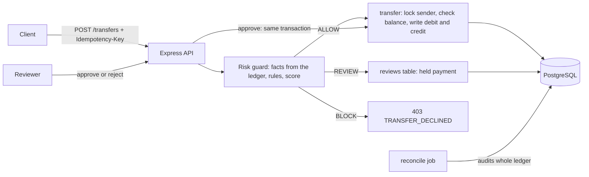

# fintech-core

A double-entry ledger service for moving money safely, with a rule-based risk engine and a human review workflow. Built with Node.js, TypeScript, Express and PostgreSQL.

The interesting part is not the API. It is the set of guarantees a payments system has to keep even when requests are retried, run at the same moment, or fail halfway. Each guarantee below is backed by a test or a script you can run.

## Run it

    docker compose up --build

The API is then at http://localhost:4001, with seeded accounts.

## Try it

    curl -i -X POST localhost:4001/transfers \
      -H "Content-Type: application/json" \
      -H "Idempotency-Key: demo-001" \
      -d '{"fromAccountId":1,"toAccountId":2,"amount_minor":1000}'

    curl localhost:4001/accounts/1/balance
    curl localhost:4001/reviews

Amounts are whole numbers in the smallest unit (paise). `1000` means 10.00 rupees.

## Architecture

Every transfer is two rows in `journal_entries`, a debit and a credit, sharing one transfer id. Balances are never stored. They are computed from the ledger, so there is no number that can drift from the truth.

## Guarantees and the evidence for each

| Guarantee | How it is enforced | Proof |
|---|---|---|
| Money is stored exactly | whole numbers in paise, never floats | design; `BIGINT` columns |
| Every transfer balances (debits = credits) | deferred constraint trigger checked at COMMIT | `reconcile` checks 1 and 3 |
| A retried request moves money once | `UNIQUE` idempotency key, original result replayed | API test: same key twice returns 200, balance drops once |
| No account is overdrawn by concurrent requests | row lock (`SELECT ... FOR UPDATE`) before the balance check | stress test: 50 simultaneous transfers against a balance that affords 10, exactly 10 succeed and the sender ends at 0 |
| A failed transfer changes nothing | single database transaction with ROLLBACK | API tests: insufficient funds (422) and unknown account (404) leave balances unchanged |
| History is never edited | append-only ledger; mistakes are fixed with a correcting transfer | `reconcile` finds problems; `db/history/correction.sql` shows a fix |
| Suspicious transfers are held or declined before money moves | rule-based risk guard: velocity, unusual amount, large first-time payment, draining the balance, daily limit | unit tests for the rules; API tests: 6th transfer in a minute returns 202, over the daily limit returns 403 |
| Every risk decision is recorded with its reasons | `risk_decision` table | API test reads the saved decision and its reason code |
| A retried held payment creates one review, not several | `UNIQUE` key on `reviews` plus lookup before judging | API test: retry returns the same review id, one review row, one decision row |
| Only one reviewer can decide a held payment | `FOR UPDATE` on the review row, status read after the lock | API test: two simultaneous approvals give one 200 and one 409, money moves once |
| Approval re-checks the balance, because the world changed while it waited | approval runs the real transfer in the same transaction, with a savepoint | transfer logic shared with normal payments; stress test covers the lock |
| A decided review is final | status only changes from PENDING_REVIEW | API test: approve after reject returns 409 and moves nothing |
| Customers never see why they were declined | reasons stay internal | API tests: declined and rejected payments return only TRANSFER_DECLINED |

The stress test was also run with the row lock removed. It failed: more than 10 transfers succeeded and the sender went negative. That is the evidence the lock does real work.

## Risk guard

Before a transfer is posted, the guard collects facts from the ledger (transfers in the last minute, the sender's average amount, whether the receiver is new, the amount sent in 24 hours, the balance) and scores them. A score of 40 or more is held for review, 70 or more is declined. The thresholds are invented for learning, not tuned on real data. Every decision is stored with its reasons for analysts and audits.

## Review workflow

A held payment waits in a review queue (`GET /reviews`, oldest first, with the guard's reasons). A reviewer approves or rejects it:

- **Approve** locks the review, runs the transfer inside the same transaction and marks it completed. If the customer spent the money while it waited, the review is marked failed with a reason, and the attempt is undone with a savepoint.
- **Reject** requires a reason and records who decided and when. No money moves, because none had.
- Decided reviews are final.

## Reconciliation

`npm run reconcile` scans the whole ledger and reports unbalanced transfers, negative customer accounts, a non-zero ledger total, and completed transfers with no entries. It exits with an error code if anything is wrong, so a scheduler or CI can notice. It is the second line of defense for anything that bypasses the application code.

## Run the checks

    npm ci
    npm test            # API tests, start their own server
    npm run test:risk   # unit tests for the risk rules
    npm run stress      # 50 concurrent transfers
    npm run reconcile   # whole-ledger audit

## API

| Method | Path | Notes |
|---|---|---|
| POST | /transfers | header `Idempotency-Key`; body `fromAccountId`, `toAccountId`, `amount_minor` |
| GET | /accounts/:id/balance | balance in paise |
| GET | /reviews | held payments awaiting a decision, oldest first |
| POST | /reviews/:id/approve | runs the held payment |
| POST | /reviews/:id/reject | body `reason` (required), `reviewer` |

Status codes: 201 created, 200 replayed retry or review decided, 202 held for review, 400 bad input, 403 declined, 404 not found, 409 review already decided, 422 insufficient funds, 500 server error.

## Limitations

Stated plainly, because they matter:

- No authentication or authorization. Anyone who can reach the API can read the review queue, including the guard's reasons, and can approve or reject. The reviewer name is an unverified claim.
- The risk guard runs outside the transfer's transaction, so two simultaneous requests can both pass the velocity check.
- The rules are simple and thresholds are invented. A fraudster sending many small transfers under every threshold would not be caught.
- Held money is not reserved: a customer can spend it while the payment waits, so approval can fail for lack of funds.
- No check yet that a review's status agrees with the ledger.
- Single PostgreSQL instance. No replication or sharding.
- Balances are computed by summing the ledger. That is correct but slow at large scale; snapshots would fix it.
- Amounts use JavaScript numbers, which are exact at this scale but not for extremely large values.
- Synthetic data only. This is a learning project and makes no compliance claims (no KYC, PCI or regulatory handling).
- The model experiment uses synthetic data, so its results say nothing about real fraud. The model sees only seven facts and cannot use signals such as device, location or account age.

## Roadmap

- Authentication and reviewer roles
- Reserve held funds with a holds account in the ledger
- Reconciliation check: review status versus ledger
- Machine learning model compared against the rules
- Outbox pattern and event stream
- Balance snapshots
- Load test with published latency numbers
