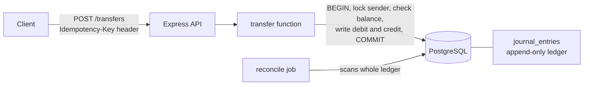

# fintech-core

A double-entry ledger service for moving money safely. Built with Node.js, TypeScript, Express and PostgreSQL.

The interesting part is not the API. It is the set of guarantees a payments system has to keep even when requests are retried, run at the same moment, or fail halfway. Each guarantee below is backed by a test or a script you can run.

## Run it

    docker compose up --build

The API is then at http://localhost:4001, with seeded accounts.

## Try it

    curl -i -X POST localhost:4001/transfers \
      -H "Content-Type: application/json" \
      -H "Idempotency-Key: demo-001" \
      -d '{"fromAccountId":1,"toAccountId":2,"amount_minor":1000}'

    curl localhost:4001/accounts/1/balance

Amounts are whole numbers in the smallest unit (paise). `1000` means 10.00 rupees.

## Architecture

Every transfer is two rows in `journal_entries`, a debit and a credit, sharing one transfer id. Balances are never stored. They are computed from the ledger, so there is no number that can drift from the truth.

## Guarantees and the evidence for each

| Guarantee | How it is enforced | Proof |
|---|---|---|
| Money is stored exactly | whole numbers in paise, never floats | design; `BIGINT` columns |
| Every transfer balances (debits = credits) | deferred constraint trigger checked at COMMIT | `reconcile` checks 1 and 3 |
| A retried request moves money once | `UNIQUE` idempotency key, original result replayed | API test: same key twice returns 200, balance drops once |
| No account is overdrawn by concurrent requests | row lock (`SELECT ... FOR UPDATE`) before the balance check | stress test: 50 simultaneous transfers against a balance that affords 10, exactly 10 succeed and the sender ends at 0 |
| A failed transfer changes nothing | single database transaction with ROLLBACK | API tests: insufficient funds (422) and unknown account (404) leave balances unchanged |
| History is never edited | append-only ledger; mistakes are fixed with a correcting transfer | `reconcile` finds problems, `db/history/correction.sql` shows a fix |
| Bad input is rejected clearly | validation with proper status codes: 400, 404, 422 | API tests |

The stress test was also run with the row lock removed. It failed: more than 10 transfers succeeded and the sender went negative. That is the evidence the lock does real work.

## Reconciliation

`npm run reconcile` scans the whole ledger and reports unbalanced transfers, negative customer accounts, a non-zero ledger total, and completed transfers with no entries. It exits with an error code if anything is wrong, so a scheduler or CI can notice. It is the second line of defense for anything that bypasses the application code.

## Run the checks

    npm ci
    npm test            # API tests, start their own server
    npm run stress      # 50 concurrent transfers
    npm run reconcile   # whole-ledger audit

CI runs all three against a fresh PostgreSQL on every push.

## API

| Method | Path | Notes |
|---|---|---|
| POST | /transfers | header `Idempotency-Key`; body `fromAccountId`, `toAccountId`, `amount_minor` |
| GET | /accounts/:id/balance | balance in paise |

Status codes: 201 created, 200 replayed retry, 400 bad input, 404 unknown account, 422 insufficient funds, 500 server error.

## Limitations

Stated plainly, because they matter:

- Single PostgreSQL instance. No replication or sharding.
- No authentication or rate limiting on the API.
- Balances are computed by summing the ledger. That is correct but slow at large scale; snapshots would fix it.
- Amounts use JavaScript numbers, which are exact at this scale but not for extremely large values.
- Synthetic data only. This is a learning project and makes no compliance claims (no KYC, PCI or regulatory handling).

## Roadmap

- Real-time risk engine that scores each transfer before it is posted (rules first, then a model)
- Outbox pattern and event stream
- Balance snapshots
- Load test with published latency numbers
